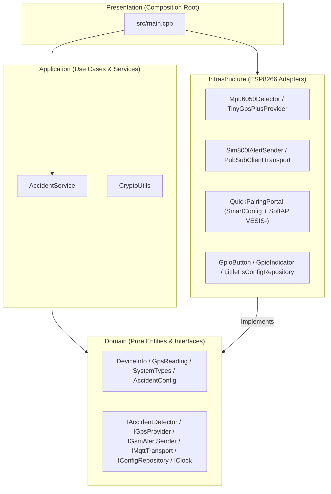

# VESIS Accident Detection & GPS Telemetry System — Clean Architecture (ESP8266)

**Real-Time Collision & Rollover Detection with MPU6050 6-Axis IMU, GPS Positioning (NEO-6M/7M/8M), Redundant Alerts via MQTT over TLS & Emergency SMS (SIM800L), Quick Pairing (SmartConfig), and `VESIS-<ChipID>` SoftAP Captive Portal**

[](https://www.espressif.com/en/products/socs/esp8266)
[](https://en.cppreference.com/w/cpp/17)
[](#system-architecture-clean-architecture)
[](https://platformio.org)

---

## Table of Contents

- [Overview](#overview)
- [Key Features](#key-features)
- [Added Functions & Modules](#added-functions--modules)
- [System Architecture (Clean Architecture)](#system-architecture-clean-architecture)
- [Project Structure](#project-structure)
- [GPIO Pinout (ESP8266 NodeMCU)](#gpio-pinout-esp8266-nodemcu)
- [2-Stage Pairing Workflow (Quick Pairing + SoftAP)](#2-stage-pairing-workflow-quick-pairing--softap)
- [Status LED Indicator](#status-led-indicator)
- [Build Instructions](#build-instructions)

---

## Overview

**VESIS GPS** is an embedded vehicular safety and telemetry firmware for the **ESP8266 NodeMCU** (`nodemcuv2`) structured in **Clean Architecture** (`domain`, `application`, `infrastructure`, `main.cpp`). It detects severe collisions and rollovers using an **MPU6050** inertial sensor, acquires satellite coordinates via **TinyGPSPlus**, transmits real-time alerts over **MQTT with TLS**, and dispatches **Emergency SMS** messages with a Google Maps location link through a **SIM800L** GSM module. It features a 2-stage pairing workflow (**Quick Pairing via `ESP-Touch / AirKiss` SmartConfig** and a **Compatible SoftAP Captive Portal `VESIS-<ChipID>`**).

---

## Key Features

| Feature | Description |
|---|---|
| **Clean Architecture** | Strict separation into `domain`, `application`, `infrastructure`, and composition root (`src/main.cpp`) |
| **Inertial Accident Detection (`MPU6050`)** | Moving-average filtering over linear acceleration and tilt angles (`roll` / `pitch`) to detect impacts and rollovers |
| **Redundant Alerts (MQTT TLS + SMS)** | Immediate MQTT publication plus emergency SMS delivery with a Google Maps link to the configured emergency phone |
| **Quick Pairing (`SmartConfig`)** | Triggered immediately upon holding the physical button (`GPIO 0`) for `5.0 s` without waiting for button release |
| **SoftAP Captive Portal (`VESIS-<ChipID>`)** | Stage 2 pairing portal triggered by a 2nd `5.0 s` long press, preserving the `VESIS-<ChipID>` SSID and `12345678` passphrase |
| **LittleFS Persistence (`/config.json`)** | Persists Wi-Fi credentials (`wifi_ssid`, `wifi_pass`), `sled_online`, `emergency_phone`, `sensitivity`, and `rollover_angle` |
| **Cryptographic Utilities (`CryptoUtils`)** | Pure C++ `MD5`, `AES-128-CBC` with PKCS#7 padding, and `Base64` primitives in the Application layer |

---

## Added Functions & Modules

### 1. Application Layer (`src/application/services/`)
- `CryptoUtils` ([`CryptoUtils.h`](file:///c:/Users/Jorge/Music/interruptor%20wifi/GPS/src/application/services/CryptoUtils.h), [`CryptoUtils.cpp`](file:///c:/Users/Jorge/Music/interruptor%20wifi/GPS/src/application/services/CryptoUtils.cpp)):
  - `computeMd5()`
  - `deriveLanKey()`
  - `aes128CbcEncryptPkcs7()`
  - `aes128CbcDecryptPkcs7()`
  - `base64Encode()`
  - `base64Decode()`
  - `decryptZeroconfPayload()`
  - `encryptZeroconfPayload()`

### 2. Infrastructure & Presentation Layers (`src/infrastructure/`, `src/main.cpp`)
- `GpioButton` ([`GpioButton.h`](file:///c:/Users/Jorge/Music/interruptor%20wifi/GPS/src/infrastructure/button/GpioButton.h), [`GpioButton.cpp`](file:///c:/Users/Jorge/Music/interruptor%20wifi/GPS/src/infrastructure/button/GpioButton.cpp)):
  - `onButtonFallingEdgeIsr()`, `init()`, `update()`, `isPhysicallyPressed()` (`25 ms` periodic sample tick, `50 ms` debounce filter, and immediate `LongPress` emission at `5,000 ms`).
- `GpioIndicator` ([`GpioIndicator.h`](file:///c:/Users/Jorge/Music/interruptor%20wifi/GPS/src/infrastructure/indicator/GpioIndicator.h)):
  - `setSledOnline()`, `isSledOnline()`, `show()`, `update()` (`100 ms` non-blocking LED pattern generator with active-low support for the NodeMCU onboard LED).
- `QuickPairingPortal` ([`QuickPairingPortal.h`](file:///c:/Users/Jorge/Music/interruptor%20wifi/GPS/src/infrastructure/provisioning/QuickPairingPortal.h), [`QuickPairingPortal.cpp`](file:///c:/Users/Jorge/Music/interruptor%20wifi/GPS/src/infrastructure/provisioning/QuickPairingPortal.cpp)):
  - `runQuickPairing()`
  - `runSoftApPortal()`
  - `runPairingWorkflow()`
- `LittleFsConfigRepository` ([`LittleFsConfigRepository.cpp`](file:///c:/Users/Jorge/Music/interruptor%20wifi/GPS/src/infrastructure/persistence/LittleFsConfigRepository.cpp)):
  - Persists `wifi_ssid`, `wifi_pass`, and `sled_online` alongside accident detection thresholds in `/config.json`.
- `updateConnectivityIndicator()` in [`main.cpp`](file:///c:/Users/Jorge/Music/interruptor%20wifi/GPS/src/main.cpp).

---

## System Architecture (Clean Architecture)



---

## Project Structure

```text
GPS/
├── platformio.ini
├── include/
│   └── config.h
└── src/
    ├── main.cpp
    ├── domain/
    │   ├── entities/ (DeviceInfo.h, GpsReading.h, SystemTypes.h)
    │   └── interfaces/ (IAccidentDetector.h, IClock.h, IConfigRepository.h, IGpsProvider.h, IGsmAlertSender.h, IMqttTransport.h)
    ├── application/
    │   ├── AccidentAlgorithm.h / .cpp
    │   └── services/ (AccidentService.h/.cpp, CryptoUtils.h/.cpp)
    └── infrastructure/
        ├── button/ (GpioButton.h/.cpp)
        ├── gps/ (TinyGpsPlusProvider.h/.cpp)
        ├── gsm/ (Sim800lAlertSender.h/.cpp)
        ├── indicator/ (GpioIndicator.h)
        ├── mqtt/ (PubSubClientTransport.h/.cpp)
        ├── persistence/ (LittleFsConfigRepository.h/.cpp)
        ├── provisioning/ (QuickPairingPortal.h/.cpp)
        ├── sensors/ (Mpu6050Detector.h/.cpp)
        └── system/ (EspClock.h/.cpp, EspSysUtils.h/.cpp)
```

---

## GPIO Pinout (ESP8266 NodeMCU)

| Peripheral | GPIO / NodeMCU Pin | Description |
|---|---|---|
| **Physical Button** (`BUTTON_PIN`) | `GPIO 0` (`D3`) | `INPUT_PULLUP` (`25 ms` sample, `50 ms` debounce, `5,000 ms` Quick Pairing) |
| **Status LED** (`wifiLed`) | `GPIO 2` (`D4`) | Onboard LED (active `LOW`, `100 ms` base tick) |
| **MPU6050 SDA / SCL** | `GPIO 4 / 5` (`D2 / D1`) | I2C bus |
| **GPS RX / TX** | `GPIO 14 / 16` (`D5 / D0`) | SoftwareSerial UART (`9600` baud) |
| **SIM800L RX / TX** | `GPIO 13 / 12` (`D7 / D6`) | SoftwareSerial UART (`9600` baud) |
| **Buzzer** (`BUZZER_PIN`) | `GPIO 15` (`D8`) | Local acoustic alert |

---

## 2-Stage Pairing Workflow (Quick Pairing + SoftAP)

1. **Stage 1 — Quick Pairing (`SmartConfig ESP-Touch / AirKiss`)**:
   - Holding the physical button (`GPIO 0`) for **5.0 seconds** immediately starts `runQuickPairing()`.
   - The status LED emits **2 short flashes + pause** (`100/100/100/700 ms`).
2. **Stage 2 — SoftAP Captive Portal (`VESIS-<ChipID>`)**:
   - Holding the button for another **5.0 seconds** while in Quick Pairing starts the **`VESIS-<ChipID>`** Wi-Fi SoftAP (password `12345678`, IP `192.168.4.1`) with fast continuous blinking (`100 ms ON / 100 ms OFF`).
   - The web form configures Wi-Fi SSID, password, emergency phone number, impact sensitivity, and rollover angle, saving all parameters to `/config.json`.
   - A **short press** cancels pairing mode and resumes normal operation.

---

## Status LED Indicator

| State (`IndicatorStatus`) | LED Cadence (`GPIO 2`) | Meaning |
|---|---|---|
| `Disconnected` | `1000 ms ON` / `1000 ms OFF` | Wi-Fi disconnected |
| `Connecting` | `200 ms ON` / `1800 ms OFF` | Wi-Fi connected, connecting to MQTT broker |
| `QuickPairing` | `100 ms ON`, `100 ms OFF`, `100 ms ON`, `700 ms OFF` | Quick Pairing mode (SmartConfig) active |
| `CompatibleAp` | `100 ms ON` / `100 ms OFF` continuous (5 Hz) | SoftAP `VESIS-<ChipID>` portal active |
| `Operational` | Steady ON (`sledOnline=true`) or OFF (`sledOnline=false`) | Connected to Wi-Fi and MQTT broker |

---

## Build Instructions

```bash
pio run -e nodemcuv2
```
