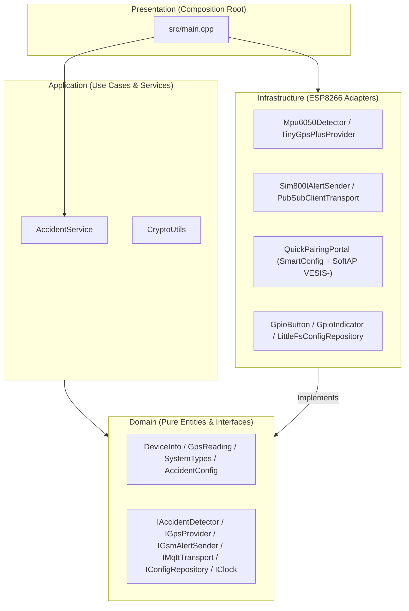

# GPS Accident Detection System - ESP8266

[](https://www.espressif.com/en/products/socs/esp8266)
[](https://docs.oasis-open.org/mqtt/mqtt/v3.1.1/os/mqtt-v3.1.1-os.html)
[](LICENSE)
[](https://deepwiki.com/JorgeGBeltre/GPS)

A comprehensive IoT-based vehicle accident detection system that monitors vehicle movements, detects accidents using MPU6050 sensor, provides GPS location tracking, and sends emergency alerts via MQTT and SMS.

## Table of Contents
- [Overview](#overview)
- [Key Features](#key-features)
- [Added Functions & Modules](#added-functions--modules)
- [System Architecture (Clean Architecture)](#system-architecture-clean-architecture)
- [Architecture](#architecture)
- [2-Stage Pairing Workflow (Quick Pairing + SoftAP)](#2-stage-pairing-workflow-quick-pairing--softap)
- [Status LED Indicator](#status-led-indicator)
- [Features](#features)
- [Backend Implementation](#backend-implementation)
- [Hardware Requirements](#hardware-requirements)
- [Pin Configuration](#pin-configuration)
- [Installation](#installation)
- [Configuration Commands](#configuration-commands)
- [MQTT Topics](#mqtt-topics)
- [API Reference](#api-reference)
- [OTA Updates](#ota-updates)
- [Common Issues](#common-issues)
- [Troubleshooting](#troubleshooting)
- [Broker Compatibility](#broker-compatibility)
- [License](#license)
- [Contact](#contact)
- [Support](#support)

## Overview

This system uses an ESP8266 microcontroller to monitor vehicle movements in real-time. It detects accidents through impact analysis and rollover detection using an MPU6050 accelerometer/gyroscope, tracks location via GPS, and automatically sends emergency notifications through MQTT and SMS alerts.

### System Evolution
The project evolved from a monolithic prototype → a modular sketch (v0.0.5) →
a **PlatformIO Clean Architecture** project. The latest overhaul organizes the
firmware into four layers with dependencies pointing **inward only**
(Presentation → Application → Domain, and Infrastructure → Domain; the Domain
layer depends on nothing), delivering higher reliability, testable business
logic, and hardware that can be swapped without touching the core.

---

## Key Features

| Feature | Description |
|---|---|
| **Clean Architecture** | Strict separation into `domain`, `application`, `infrastructure`, and composition root (`src/main.cpp`) |
| **Inertial Accident Detection (`MPU6050`)** | Moving-average filtering over linear acceleration and tilt angles (`roll` / `pitch`) to detect impacts and rollovers |
| **Redundant Alerts (MQTT TLS + SMS)** | Immediate MQTT publication plus emergency SMS delivery with a Google Maps link to the configured emergency phone |
| **Quick Pairing (`SmartConfig`)** | Triggered on unprovisioned first boot or immediately upon holding the physical button (`GPIO 0`) for `5.0 s` without waiting for button release |
| **SoftAP Captive Portal (`VESIS-<ChipID>`)** | Stage 2 pairing portal triggered by a 2nd `5.0 s` long press (or initial boot fallback), disabling background STA `autoReconnect` (`WiFi.setAutoReconnect(false)`) for channel stability and exposing both the HTML captive portal and Compatible Pairing JSON endpoints (`GET /device`, `POST /ap`) on `VESIS-<ChipID>` (`12345678`) |
| **LittleFS Persistence (`/config.json`)** | Persists Wi-Fi credentials (`wifi_ssid`, `wifi_pass`), cellular `apn` (default `""`), `apn_user`, `apn_pass`, MQTT broker (`mqtt_server`, `mqtt_port`, `mqtt_user`, `mqtt_pass`), `device_key`, `bind_token`, `account_bound`, `sled_online`, `emergency_phone`, `sms_enabled`, `sensitivity`, `rollover_angle`, and `alert_delay` |
| **Harsh Driving & Peak-G Vector (`GTHBM` / `GTCRA`)** | Evaluates 3-axis peak G-force magnitude (`peak_g`), harsh braking (`harsh_braking`), harsh acceleration (`harsh_acceleration`), harsh cornering (`harsh_cornering`), and virtual ignition (`virtual_ignition`) |
| **Static GPS Drift Filter & Tow Detection (`GTRDF` / `GTTOW`)** | Pins stationary coordinates within a `30 m` anchor radius (`< 3.0 km/h`) and detects unauthorized parked towing (`> 100 m` displacement) |
| **MCC/MNC Carrier Auto-APN & Jamming Detection (`GTJDC`)** | Auto-resolves the SIM800L carrier APN from `AT+CIMI` (IMSI MCC/MNC table) when unconfigured (`apn == ""`) and monitors `AT+CSQ` + `AT+CREG?` for cellular RF jamming |
| **Cellular LBS & Cell ID Positioning (`AT+CREG=2` / `AT+CGREG=2` / `AT+CLBS=1,1` / `AT+CIPGSMLOC=1,1`)** | Extracts 2G GSM serving cell parameters (`mcc`, `mnc`, `lac`, `cell_id`) from `AT+CIMI` and extended `+CREG?` / `+CGREG?` (`=2`), falls back to SIM800L base-station coordinates (`AT+CLBS=1,1` / `AT+CIPGSMLOC=1,1`, `pos_src = "LBS"` / `"LBS_CELL_ID"`, `lbs_fallback = true`) when the NEO-6M GPS lacks a satellite fix, and appends `Ubic(LBS)` + `Celda LBS: <mcc>-<mnc>-<lac>-<cellId>` to emergency SMS alerts, `STATUS` SMS replies, and MQTT `telemetry`/`accidents` JSON payloads |
| **Family Identity & Dynamic `credential_mode`** | Exposes `device_family = "gps_esp8266"` (`device_code = 3`) and dynamic `credential_mode` (`"apn"` vs `"adopt_only"` with `apn_auto_detected` / `adopt_ready` from the pre-pairing SIM800L probe) on `GET /device` and `POST /ap`, allowing 1-tap account adoption without overwriting stored Wi-Fi/APN |
| **Account Binding & BearSSL Cryptographic Unlink (`account_bound`)** | Connects with `ClientId == <ChipID>` (rejecting unprovisioned empty or `"EXAMPLE_API_KEY"` credentials), publishes a retained Last Will and Testament (`status/<ChipID>`), auto-selects plain TCP (`:1883`) vs BearSSL TLS (`:8084` / `:8883`) with a bounded `2048`-byte MQTT packet buffer (`MQTT_BUFFER_SIZE = 2048`), preserves credentials across Wi-Fi outages while `account_bound = true`, and wipes `/config.json` into Stage 1 Quick Pairing upon constant-time BearSSL `SHA-256` verification on `devices/<ChipID>/unlink/command` |
| **Offline Alert Ring-Buffer (`+BUFF`)** | Queues up to `8` telemetry/accident messages in `PubSubClientTransport` when Wi-Fi/MQTT is disconnected and automatically flushes them upon reconnection |
| **Cryptographic Utilities (`CryptoUtils`)** | Pure C++ `MD5`, `AES-128-CBC` with PKCS#7 padding, and `Base64` primitives in the Application layer |

---

## Added Functions & Modules

### 1. Application Layer (`src/application/services/`)
- `CryptoUtils` ([`CryptoUtils.h`](file:///c:/Users/Jorge/Music/interruptor%20wifi/GPS/src/application/services/CryptoUtils.h), [`CryptoUtils.cpp`](file:///c:/Users/Jorge/Music/interruptor%20wifi/GPS/src/application/services/CryptoUtils.cpp)):
  - `computeMd5()`
  - `deriveLanKey()`
  - `aes128CbcEncryptPkcs7()`
  - `aes128CbcDecryptPkcs7()`
  - `base64Encode()`
  - `base64Decode()`
  - `decryptZeroconfPayload()`
  - `encryptZeroconfPayload()`

### 2. Infrastructure & Presentation Layers (`src/infrastructure/`, `src/main.cpp`)
- `GpioButton` ([`GpioButton.h`](file:///c:/Users/Jorge/Music/interruptor%20wifi/GPS/src/infrastructure/button/GpioButton.h), [`GpioButton.cpp`](file:///c:/Users/Jorge/Music/interruptor%20wifi/GPS/src/infrastructure/button/GpioButton.cpp)):
  - `onButtonFallingEdgeIsr()`, `init()`, `update()`, `isPhysicallyPressed()` (`25 ms` periodic sample tick, `50 ms` debounce filter, and immediate `LongPress` emission at `5,000 ms`).
- `GpioIndicator` ([`GpioIndicator.h`](file:///c:/Users/Jorge/Music/interruptor%20wifi/GPS/src/infrastructure/indicator/GpioIndicator.h)):
  - `setSledOnline()`, `isSledOnline()`, `show()`, `update()` (`100 ms` non-blocking LED pattern generator with active-low support for the NodeMCU onboard LED).
- `QuickPairingPortal` ([`QuickPairingPortal.h`](file:///c:/Users/Jorge/Music/interruptor%20wifi/GPS/src/infrastructure/provisioning/QuickPairingPortal.h), [`QuickPairingPortal.cpp`](file:///c:/Users/Jorge/Music/interruptor%20wifi/GPS/src/infrastructure/provisioning/QuickPairingPortal.cpp)):
  - `setCellularState()` (injects pre-pairing SIM800L `simPresent`, `apnAutoDetected`, and `resolvedApn` snapshot)
  - `runQuickPairing()`
  - `runSoftApPortal()` (serves `device_family = "gps_esp8266"`, `device_code = 3`, `credential_mode`, `adopt_ready`, and `account_bound` on `GET /device` / `POST /ap` with `WiFi.setAutoReconnect(false)`)
  - `runPairingWorkflow()`
- `LittleFsConfigRepository` ([`LittleFsConfigRepository.cpp`](file:///c:/Users/Jorge/Music/interruptor%20wifi/GPS/src/infrastructure/persistence/LittleFsConfigRepository.cpp)):
  - Persists `wifi_ssid`, `wifi_pass`, `apn`, `apn_user`, `apn_pass`, `mqtt_server`, `mqtt_port`, `mqtt_user`, `mqtt_pass`, `device_key` (with deterministic hardware-derived default), `bind_token`, `account_bound`, and `sled_online` alongside accident detection thresholds in `/config.json`.
- `AccidentAlgorithm` & `Mpu6050Detector` ([`AccidentAlgorithm.cpp`](file:///c:/Users/Jorge/Music/interruptor%20wifi/GPS/src/application/AccidentAlgorithm.cpp), [`Mpu6050Detector.cpp`](file:///c:/Users/Jorge/Music/interruptor%20wifi/GPS/src/infrastructure/sensors/Mpu6050Detector.cpp)):
  - `peak_g`, `harsh_braking`, `harsh_acceleration`, `harsh_cornering`, and `virtual_ignition` evaluation.
- `TinyGpsPlusProvider` ([`TinyGpsPlusProvider.cpp`](file:///c:/Users/Jorge/Music/interruptor%20wifi/GPS/src/infrastructure/gps/TinyGpsPlusProvider.cpp)):
  - Static GPS Drift Filter (`GTRDF`, `30 m` radius when `< 3.0 km/h`) and Parked Tow Detection (`GTTOW`, `>= 100 m` displacement).
- `Sim800lAlertSender` ([`Sim800lAlertSender.cpp`](file:///c:/Users/Jorge/Music/interruptor%20wifi/GPS/src/infrastructure/gsm/Sim800lAlertSender.cpp)):
  - `autoResolveCarrierApn()` (MCC/MNC IMSI carrier APN lookup), `pollLbsCellInfo()` / `enrichWithLbs()` (GSM Cell ID `mcc`/`mnc`/`lac`/`cellId` via `AT+CREG=2`/`AT+CGREG=2` + base-station coordinate fallback via `AT+CLBS=1,1` and `AT+CIPGSMLOC=1,1`), and `isJammingDetected()` (`GTJDC` RF jamming check).
- `PubSubClientTransport` ([`PubSubClientTransport.cpp`](file:///c:/Users/Jorge/Music/interruptor%20wifi/GPS/src/infrastructure/mqtt/PubSubClientTransport.cpp)):
  - `enqueueOffline()` and `flushOfflineQueue()` (`+BUFF` 8-slot offline alert store-and-forward buffer), `{ChipID}`-scoped MQTT subscriptions (`event/<ChipID>`, `config/<ChipID>`, `devices/<ChipID>/unlink/command`), retained Last Will and Testament (`status/<ChipID>`, QoS `1`), unprovisioned credential guard (blocking empty or `"EXAMPLE_API_KEY"` logins), bounded `2048`-byte inbound payload validation (`length <= MQTT_BUFFER_SIZE` with `message.reserve(length + 1)`), automatic plain TCP (`:1883`) vs BearSSL TLS selection, and constant-time BearSSL `SHA-256` (`br_sha256_context`) `unlink_proof` verification.
- `updateConnectivityIndicator()` in [`main.cpp`](file:///c:/Users/Jorge/Music/interruptor%20wifi/GPS/src/main.cpp).

---

## System Architecture (Clean Architecture)



---

## 2-Stage Pairing Workflow (Quick Pairing + SoftAP)

1. **Stage 1 — Quick Pairing (`SmartConfig ESP-Touch / AirKiss`)**:
   - Holding the physical button (`GPIO 0`) for **5.0 seconds** immediately starts `runQuickPairing()`.
   - The status LED emits **2 short flashes + pause** (`100/100/100/700 ms`).
2. **Stage 2 — SoftAP Captive Portal (`VESIS-<ChipID>`)**:
   - Holding the button for another **5.0 seconds** while in Quick Pairing starts the **`VESIS-<ChipID>`** Wi-Fi SoftAP (password `12345678`, IP `192.168.4.1`, `WiFi.setAutoReconnect(false)`) with fast continuous blinking (`100 ms ON / 100 ms OFF`).
   - Exposes both the HTML web form and the Compatible Pairing JSON endpoints (`GET /device`, `POST /ap`) advertising `device_family = "gps_esp8266"`, `device_code = 3`, and dynamic `credential_mode` (`"apn"` vs `"adopt_only"` when SIM800L auto-resolved the carrier APN or Wi-Fi is already stored while unbound) to configure Wi-Fi SSID, password, cellular APN (`apn`, `apn_user`, `apn_pass`), MQTT broker/port/credentials, `bind_token`, `account_bound`, emergency phone number, SMS enable flag, impact sensitivity, rollover angle, and alert delay, saving all parameters to `/config.json` (while preserving stored Wi-Fi/APN on `adopt_only` account binding).
   - A **short press** cancels pairing mode and resumes normal operation.

---

## Status LED Indicator

| State (`IndicatorStatus`) | LED Cadence (`GPIO 2`) | Meaning |
|---|---|---|
| `Disconnected` | `1000 ms ON` / `1000 ms OFF` | Wi-Fi disconnected |
| `Connecting` | `200 ms ON` / `1800 ms OFF` | Wi-Fi connected, connecting to MQTT broker |
| `QuickPairing` | `100 ms ON`, `100 ms OFF`, `100 ms ON`, `700 ms OFF` | Quick Pairing mode (SmartConfig) active |
| `CompatibleAp` | `100 ms ON` / `100 ms OFF` continuous (5 Hz) | SoftAP `VESIS-<ChipID>` portal active |
| `Operational` | Steady ON (`sledOnline=true`) or OFF (`sledOnline=false`) | Connected to Wi-Fi and MQTT broker |

---

## Architecture

The firmware is organized into four layers under `src/`:

```
src/
├── domain/                         # Enterprise rules — no hardware, no libs
│   ├── entities/
│   │   ├── AccidentEvent.h         # (hardware-free, host-testable)
│   │   ├── GpsLocation.h
│   │   ├── DeviceInfo.h
│   │   └── SystemTypes.h           # WiFiStatus, OTAContext
│   └── interfaces/                 # Pure abstractions (ports)
│       ├── IGpsProvider.h
│       ├── IGsmAlertSender.h
│       ├── IMqttTransport.h
│       ├── IAccidentDetector.h
│       ├── IConfigRepository.h
│       └── IClock.h
│
├── application/                    # Use cases — depends only on interfaces
│   ├── AccidentAlgorithm.{h,cpp}   # Pure STA/LTA + rollover math (host-tested)
│   └── services/
│       ├── AccidentService.{h,cpp} # Orchestrates detect → alert → publish
│       └── CryptoUtils.{h,cpp}     # Pure MD5, AES-128-CBC (PKCS#7) & Base64
│
├── infrastructure/                 # Adapters — concrete impls of the ports
│   ├── button/GpioButton.{h,cpp}   # 25 ms tick sampler, 50 ms debounce, 5 s LongPress
│   ├── gps/TinyGpsPlusProvider.{h,cpp}
│   ├── gsm/Sim800lAlertSender.{h,cpp}
│   ├── indicator/GpioIndicator.h   # Non-blocking 100 ms LED pattern state machine
│   ├── mqtt/PubSubClientTransport.{h,cpp}
│   ├── provisioning/QuickPairingPortal.{h,cpp} # 2-stage SmartConfig + SoftAP VESIS-<ChipID>
│   ├── sensors/Mpu6050Detector.{h,cpp}
│   ├── persistence/LittleFsConfigRepository.{h,cpp}
│   └── system/{EspClock,EspSysUtils}.{h,cpp}
│
└── main.cpp                        # Presentation / composition root

include/config.h                    # Shared pins & constants (global)
test/test_accident_algorithm/       # Native unit tests (no hardware)
data/config.json                    # Default LittleFS config (uploadfs)
legacy/                             # Original flat sketch (kept, NOT compiled)
```

### Key ideas

- **Dependency inversion.** `AccidentService` and `Mpu6050Detector` never name a
  concrete class; they receive `IGpsProvider`, `IGsmAlertSender`,
  `IMqttTransport`, `IConfigRepository` and `IClock` through their constructors.
  Only `main.cpp` (the composition root) wires the concrete implementations
  together.
- **Swappable adapters.** Changing the GPS chip (NEO-6M → NEO-8M) or the GSM
  modem (SIM800L → SIM7600) means writing one new class in `infrastructure/` and
  changing one line in `main.cpp` — no business-logic changes.
- **Testable core.** `AccidentAlgorithm` was split out of the MPU6050 driver so
  the impact/rollover logic runs on the host with no hardware. See
  `test/test_accident_algorithm/`.

### Legacy module mapping

The original flat modules were reorganized into the layers above (the old files
remain under `legacy/` for reference and are not compiled):

| Legacy file          | Now lives in                                                        |
|----------------------|---------------------------------------------------------------------|
| `GPS.ino`            | `src/main.cpp` (composition root)                                   |
| `Types.h`            | `src/domain/entities/*` + `SystemTypes.h`                           |
| `config.h`           | `include/config.h`                                                  |
| `AccidentMonitor.*`  | `src/infrastructure/sensors/Mpu6050Detector.*` + `src/application/AccidentAlgorithm.*` |
| `GpsModule.*`        | `src/infrastructure/gps/TinyGpsPlusProvider.*`                      |
| `GsmModule.*`        | `src/infrastructure/gsm/Sim800lAlertSender.*`                       |
| `MqttClientModule.*` | `src/infrastructure/mqtt/PubSubClientTransport.*`                   |
| `DeviceConfig.*`     | `src/infrastructure/persistence/LittleFsConfigRepository.*`         |
| `SysUtils.*`         | `src/infrastructure/system/EspClock.*` + `EspSysUtils.*`            |

## Features

### Core Functionality
- **Real-time Accident Detection**: Impact and rollover detection using MPU6050
- **GPS Tracking**: Location monitoring with TinyGPSPlus
- **Dual Alert System**: MQTT notifications + SMS emergency alerts
- **Wireless Connectivity**: WiFi with automatic reconnection
- **Secure Communication**: MQTTS with SSL/TLS encryption
- **Over-the-Air Updates**: Remote firmware updates via MQTT
- **Multiple Configuration Methods**: Serial, SMS, MQTT, and Web Interface

### Technical Features
- **Modular C++ Design (OOD)**: Decoupled hardware managers for high scalability.
- **Configurable Sensitivity**: Adjustable impact sensitivity and rollover angles.
- **Buzzer Alerts**: Audible notifications for accidents.
- **LED Status Indicators**: Visual WiFi connection status.
- **LittleFS JSON Configuration**: Persistent settings stored as JSON (modern alternative to EEPROM).
- **NTP Time Synchronization**: Accurate timestamping for event logs.
- **GSM Module Support**: SIM800L with automated command processing.
- **Multi-protocol Command Interface**: Serial, SMS, and MQTT configuration callbacks.

## Hardware Requirements

### Microcontroller
- **ESP8266 NodeMCU** (ESP-12E/ESP-12S)

### Sensors & Modules
- **MPU6050**: Accelerometer and gyroscope for motion detection
- **GPS Module**: NEO-6M or compatible for location tracking
- **GSM Module**: SIM800L for SMS alerts
- **Buzzer**: Piezo buzzer for audible alerts
- **LED**: Status indicator LED
- **Button**: Physical button for configuration

## Pin Configuration

| Component | GPIO Pin | NodeMCU Pin | Function |
|-----------|----------|-------------|----------|
| Button | GPIO0 | D3 | Configuration/Reset |
| WiFi LED | GPIO2 | D4 | Status indicator |
| Buzzer | GPIO15 | D8 | Audible alerts |
| GSM RX | GPIO13 | D7 | SIM800L RX |
| GSM TX | GPIO12 | D6 | SIM800L TX |
| GPS RX | GPIO14 | D5 | GPS Module RX |
| GPS TX | GPIO16 | D0 | GPS Module TX |
| I2C SDA | GPIO4 | D2 | MPU6050 SDA |
| I2C SCL | GPIO5 | D1 | MPU6050 SCL |

## Installation

This is a **PlatformIO** project. Use the PlatformIO IDE extension (VS Code) or
the `pio` CLI. Dependencies are declared in `platformio.ini` and fetched
automatically — no manual library installation needed.

### Prerequisites
- [PlatformIO Core](https://docs.platformio.org/en/latest/core/installation/index.html) (CLI) or the PlatformIO IDE extension for VS Code
- Library dependencies (auto-installed from `platformio.ini`):
  - `mikalhart/TinyGPSPlus`
  - `knolleary/PubSubClient`
  - `bblanchon/ArduinoJson` (v6)
  - `electroniccats/MPU6050`
- `SoftwareSerial`, `ESP8266WiFi`, `WiFiClientSecure`, `ArduinoOTA`, `LittleFS`
  and `EEPROM` ship with the ESP8266 Arduino core and are **not** listed in
  `lib_deps`.

### Setup Steps
1. Clone the repository and open the `GPS` folder in VS Code (PlatformIO) or a terminal.
2. Configure hardware connections (see [Pin Configuration](#pin-configuration)).
3. Update settings in `include/config.h` (WiFi certificate, MQTT server, pins).
4. Build, upload the filesystem, and flash the firmware (commands below).

### Build & test

```bash
pio run                 # build firmware for nodemcuv2 (ESP8266)
pio run -t upload       # flash firmware
pio run -t uploadfs     # upload data/ (config.json) to LittleFS
pio test -e native      # run host unit tests for AccidentAlgorithm (needs a host GCC — MinGW-w64 on Windows, or WSL)
pio device monitor      # serial monitor @ 115200
```

### Notes / deviations from the original sketch

1. `MQTT_TOPIC_CONFIG` was **referenced but never defined** in the original
   `config.h` (the sketch would not compile as-is). It is now defined in
   `include/config.h` as the PROGMEM `"config"` topic — adjust if needed.
2. The original `loop()` passed an always-empty `GPSData` to the SMS alert, so
   alerts never carried a location. `AccidentService::process()` now reads the
   live fix from `IGpsProvider` before alerting. This is a behavior change (an
   intentional bug fix); revert inside `AccidentService.cpp` if undesired.
3. `Serial`/OTA command handling beyond the `STATUS` SMS was not present in the
   original `loop()` and was **not invented** here. The command set documented
   below is a natural follow-up to wire into a dedicated `CommandRouter`.

## Configuration Commands

The system includes multiple ways to configure accident detection parameters:

### 1. Serial Port Commands (Serial Monitor)

Connect to the serial port (115200 baud) and use the following commands:

#### Basic Configuration
```bash
set phone +18291234567         # Change emergency phone number
set sensitivity 2500           # Change sensitivity (500-10000)
set angle 60                   # Change rollover angle (10-90°)
set delay 30000                # Change alert delay (1000-600000ms)
set sms on                     # Enable/disable SMS alerts (on/off)
save                           # Save configuration to EEPROM
```

#### System Commands
```bash
help or ?                      # Show command menu
config or show                 # Show current configuration
status                         # Publish status via MQTT
location                       # Get and publish GPS location
test_sms                       # Send test SMS
sms_test                       # Send SMS test to configured number
```

#### Diagnostics
```bash
wifi                           # Show WiFi information
mqtt                           # Show/connect MQTT status
gsm                            # Check GSM module
gps                            # Show GPS information
gps_debug                      # Complete GPS diagnostic
gps_raw                        # Show RAW GPS data for 5 seconds
reset                          # Restart device
```

### 2. SMS Commands

Send SMS to the configured emergency phone number:

#### Available SMS Commands
```
HELP or AYUDA or ?             # Show command menu
STATUS or ESTADO               # System status
LOCATION or UBICACION or LOC   # Current GPS location
CONFIG or CONFIGURACION        # Current configuration
TEST or TEST_SMS               # Test SMS to emergency number
```

#### SMS Configuration Commands
```
SET PHONE [number]             # Change emergency phone number
SET SENS [value]               # Change sensitivity (500-10000)
SET ANGLE [degrees]            # Change rollover angle (10-90)
SET DELAY [ms]                 # Change alert delay (1000-600000)
SET SMS [ON/OFF]               # Enable/disable SMS
SAVE or GUARDAR                # Save configuration
```

#### System SMS Commands
```
WIFI or WIFI INFO              # WiFi information
GPS                            # GPS status
GSM                            # GSM module status
MQTT                           # MQTT status
RESET or REINICIAR             # Restart device
```

### 3. MQTT Commands

#### Direct Commands
Send to topic `commands/{device_id}`:
- `reset`: Restart the device
- `status`: Request status report
- `location`: Request immediate GPS location
- `get_config`: Get current configuration

#### JSON Configuration via MQTT
Send JSON to topic `config/{device_id}`:
```json
{
  "sensitivity": 2500,
  "rollover_angle": 60,
  "alert_delay": 30000,
  "sms_enabled": true,
  "emergency_phone": "+18291234567"
}
```

### 4. Web Interface Configuration (WiFiManager)

1. **Activate AP mode**: Press and hold the physical button for `5.0 seconds` (`5000 ms`) to enter Stage 1 Quick Pairing, and hold for a 2nd `5.0 seconds` to open the SoftAP portal
2. **Connect**: WiFi SSID: `VESIS-{CHIP_ID}`, Password: `12345678`
3. **Configure**: Enter your WiFi SSID, password, cellular APN (or submit `adopt_only` account-binding credentials via `POST /ap`)
4. **Restart**: The device will restart automatically

### Default Values and Ranges

| Parameter | Default Value | Acceptable Range |
|-----------|---------------|------------------|
| Sensitivity | 2000 | 500 - 10000 |
| Rollover Angle | 60° | 10° - 90° |
| Alert Delay | 30000ms | 1000 - 600000ms |
| Emergency Phone | - | Minimum 10 digits |
| SMS Enabled | true | true/false |

### Configuration Examples

#### Example 1: Basic Serial Configuration
```bash
set phone +18295551234
set sensitivity 3000
set angle 70
set delay 15000
set sms on
save
```

#### Example 2: SMS Configuration
```
SET PHONE +18295556789
SET SENS 4000
SET ANGLE 65
SET DELAY 20000
SET SMS ON
SAVE
```

#### Example 3: SMS Verification
```
HELP         # View all commands
STATUS       # View current status
CONFIG       # View configuration
LOCATION     # Get location
```

### Configuration Persistence

- **LittleFS Storage (v0.0.5)**: Configuration is now stored in a `config.json` file. This provides atomic writes and human-readable settings via the file system.
- **EEPROM Migration**: The system has transitioned from raw EEPROM addresses to the LittleFS filesystem for improved reliability and data integrity.
- **Auto-Load**: Current settings are automatically loaded from `/config.json` on startup.
- **Validation**: Strict range validation is performed before any change is persisted.
- **Data Upload**: Remember to upload the `data` folder using the **ESP8266 LittleFS Data Upload** tool before the first run.

### Important Notes

1. **Modular Architecture**: Commands are now handled via a clean callback system (`onSmsReceived`, `onMqttEvent`), making the system highly extensible.
2. **SMS Authorization**: Only the configured emergency number can send SMS commands.
3. **Phone Format**: Numbers must have at least 10 digits and can include `+`, spaces, and dashes.
4. **Restart Required**: Certain changes require a restart to be fully applied to hardware modules.
5. **Confirmation**: Successful configuration changes trigger confirmations via MQTT/SMS/Serial.

### Advanced Diagnostic Commands

```bash
gps_debug     # Complete GPS diagnostic
gps_raw       # View raw NMEA data
gps           # Current GPS status
gsm           # Verify GSM module
```

These commands provide detailed information for troubleshooting hardware and connectivity issues.

### Accident Detection Settings
```cpp
struct AccidentConfig {
  int sensitivity = 2000;                  // Impact sensitivity threshold
  int rollover_angle = 60;                 // Rollover detection angle
  unsigned long alert_delay = 30000UL;     // Alert delay in milliseconds
  char emergency_phone[21] = "+18290000000"; // Emergency contact number
  bool sms_enabled = true;                 // Enable/disable SMS alerts
  char wifi_ssid[33] = "";
  char wifi_pass[65] = "";
  char apn[48] = "";                       // Empty default enables SIM800L carrier auto-APN
  char apn_user[33] = "";
  char apn_pass[33] = "";
  char mqtt_server[65] = "example.com";
  int mqtt_port = 8084;                    // Auto-selects plain TCP on 1883 vs BearSSL TLS
  char mqtt_user[65] = "";                 // Must be provisioned (empty or "EXAMPLE_API_KEY" is rejected)
  char mqtt_pass[65] = "";
  char device_key[37] = "";
  char bind_token[65] = "";
  bool sled_online = true;
  bool account_bound = false;              // Distinguishes temporary Wi-Fi loss from account unlink
};
```

### MQTT Configuration
```cpp
constexpr const char* MQTT_SERVER = "example.com";
constexpr int MQTT_PORT = 8084;
constexpr const char* API_KEY = "";
constexpr size_t MQTT_BUFFER_SIZE = 2048;
constexpr unsigned long MQTT_KEEP_ALIVE = 120UL;
```

## MQTT Topics

### Communication Channels
`PubSubClientTransport` connects with `ClientId == <ChipID>` and scopes inbound device subscriptions by `<ChipID>`:

| Topic | Direction | Purpose |
|-------|-----------|---------|
| `telemetry` / `telemetry/<ChipID>` | Outgoing | GPS location data |
| `events` / `events/<ChipID>` | Outgoing | System events and accident alerts |
| `event/<ChipID>` | Incoming | Cloud envelope and device control commands |
| `commands/<ChipID>` | Incoming | Device control commands |
| `ota/<ChipID>` | Incoming | Firmware update commands |
| `status` / `status/<ChipID>` | Outgoing | Device status information |
| `config/<ChipID>` | Bidirectional | Scoped JSON configuration management |
| `devices/<ChipID>/unlink/command` | Incoming | Cryptographically verified account unlink (`unlink_proof = SHA256(deviceKey + ":UNLINK:" + chipId)[0..31]`) |

## API Reference

### Command Processing
The system responds to various MQTT commands:

#### System Commands
- `reset`: Restart the device
- `status`: Request current status report
- `location`: Request immediate GPS location
- `get_config`: Retrieve current configuration

#### Configuration Commands
Send JSON to `config/<ChipID>` topic:
```json
{
  "sensitivity": 2000,
  "rollover_angle": 60,
  "alert_delay": 30000,
  "sms_enabled": true,
  "emergency_phone": "+1234567890"
}
```

### Event Publishing
The system publishes structured JSON events:

#### Accident Event Example
```json
{
  "Device": {
    "status": "connected",
    "ChipId": "ABC123",
    "MacAddress": "AA:BB:CC:DD:EE:FF",
    "IPAddress": "192.168.1.100",
    "ChipType": "ESP8266",
    "FirmwareVersion": "v0.0.6"
  },
  "Timestamp": "2024-01-15T10:30:45.123Z",
  "Details": {
    "chipId": "ABC123",
    "accident": {
      "impact_detected": true,
      "rollover_detected": false,
      "impact_magnitude": 2450.5,
      "roll_angle": 15.2,
      "pitch_angle": 5.8,
      "gps_data": {
        "latitude": 40.7128,
        "longitude": -74.0060,
        "is_valid": true
      },
      "config": {
        "sensitivity": 2000,
        "rollover_angle": 60,
        "alert_delay": 30000,
        "sms_enabled": true
      }
    }
  }
}
```

## OTA Updates

### Firmware Update Process
The system supports chunked OTA updates via MQTT:

#### Update Initiation
```json
{
  "EventType": "UpdateFirmwareDevice",
  "Details": {
    "FirmwareVersion": "v1.0.0",
    "Base64Part": "[base64_encoded_data]",
    "PartIndex": 1,
    "TotalParts": 10,
    "TotalSize": 500000
  }
}
```

#### Update Progress Tracking
- Progress Updates: Published every 25% completion
- Error Handling: Automatic rollback on failure
- Memory Management: Optimized for ESP8266 constraints
- Timeout Protection: 7-minute update timeout

### OTA Features
- Chunked Transfer: Handles large firmware files in parts
- Base64 Encoding: Secure data transmission
- Progress Reporting: Real-time update status
- Error Recovery: Automatic cleanup on failure
- Version Validation: Prevents downgrade attacks

## Common Issues

#### WiFi Connection Problems
- Symptoms: Rapid LED blinking, no MQTT connection
- Solutions: 
  - Check WiFi credentials
  - Use physical button to enter AP mode
  - Verify signal strength

#### GPS Not Working
- Symptoms: Invalid location data, no satellite lock
- Solutions:
  - Check antenna connection
  - Ensure outdoor placement
  - Verify baud rate (9600)

#### MQTT Connection Issues
- Symptoms: No message publishing/subscription
- Solutions:
  - Verify MQTT server credentials
  - Check SSL certificate configuration
  - Confirm network connectivity

#### Accident Detection False Positives
- Solutions:
  - Adjust sensitivity in configuration
  - Modify vibration damping parameters
  - Calibrate MPU6050 sensor

#### Command Interface Issues
If commands don't work:
1. Verify MQTT/WiFi/GPS connection
2. Confirm SMS number is correctly configured
3. Check syntax (uppercase/lowercase)
4. Verify available memory (`status` command)
5. Check serial logs for specific errors

### Debug Mode
Enable debug output by defining `ENABLE_DEBUG` in `include/config.h`:
```cpp
#define ENABLE_DEBUG
```

### Status Indicators
| LED Pattern | Status |
|-------------|--------|
| Solid ON | WiFi connected |
| Slow Blink | WiFi connecting |
| Fast Blink | WiFi disconnected |
| Buzzer Sound | Accident detected |

## Troubleshooting

For issues and questions:
1. Check the troubleshooting section
2. Verify hardware connections
3. Ensure proper power supply
4. Review MQTT broker configuration
5. Use diagnostic commands for detailed debugging


---

## Backend Implementation

To use MQTTOTA in your project, you'll need an MQTT server to manage OTA updates. You can implement your own backend using our reference repository:

**MQTT Broker for OTA Updates**
- **Repository:** [github.com/Ruben890/Mqtt-Broker](https://github.com/Ruben890/Mqtt-Broker)
- **Description:** Complete backend for managing OTA updates via MQTT/MQTTS
- **Features:**
  - Configurable MQTT server
  - IoT device management
  - Firmware update delivery
  - OTA progress tracking
  - Error handling and retry mechanisms

**Steps to use the backend:**
1. Clone the backend repository
2. Configure the MQTT broker according to your needs
3. Implement the update delivery logic
4. Connect your ESP32 devices to the broker
5. Manage OTA updates from a centralized interface

**Example workflow:**
```javascript
// From your backend
1. Prepare firmware in base64 format
2. Publish MQTT message to target device
3. Monitor progress via callbacks
4. Confirm successful completion
5. Log results in database
```

The backend provides a scalable architecture for managing multiple devices simultaneously, with support for mass updates and firmware version management.

---

## Broker Compatibility

Tested with:
- [Mosquitto](https://mosquitto.org/) 2.0+
- [EMQX](https://www.emqx.com/) 5.0+
- [HiveMQ Cloud](https://www.hivemq.com/)
- [AWS IoT Core](https://aws.amazon.com/iot-core/)
- ESP-IDF MQTT client (used in `BasicOTA` example)

---


## License

Licensed under the **MIT License**. See [LICENSE](LICENSE) for details.

---

## Contact

Author: **Jorge Gaspar Beltre Rivera**  
Project: **GPS Accident Detection System - ESP8266**

<p align="center">
  <a href="https://www.linkedin.com/in/jorge-gaspar-beltre-rivera/" target="_blank"></a>
  <a href="https://github.com/JorgeGBeltre" target="_blank"></a>
  <a href="mailto:Jorgegaspar3021@gmail.com"></a>

</p>

## Support

This project is developed independently. Even a small contribution helps me dedicate more time to development, testing, and releasing new features.


 <p align="center">
  <a href="https://www.paypal.com/donate/?hosted_button_id=2VLA8BWT967LU">
    
  </a>
</p>
